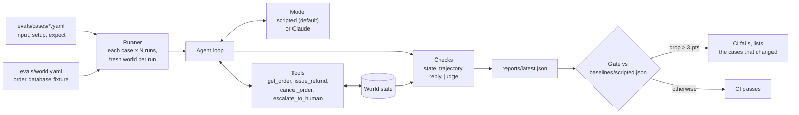

# agent-evals-starter

[](https://github.com/MoAlrubaie/agent-evals-starter/actions/workflows/ci.yml)

[](LICENSE)

A small, runnable eval harness for a tool-using AI agent: test cases in YAML, checks on the
state of the world instead of the wording of the reply, every case run several times, and a
CI gate that fails the build when the pass rate regresses.

Agents change behavior whenever you touch a prompt, a tool description or a model version,
and "I tried three examples and it seemed fine" doesn't catch what broke. This repo shows the
alternative in a dozen short files of plain Python you can read in one sitting, and it runs in
seconds with **no API key**.

## Quick start

You need Python 3.10 or newer and `make`.

```bash
git clone https://github.com/MoAlrubaie/agent-evals-starter.git
cd agent-evals-starter
make demo
```

`make demo` creates a virtualenv, runs 20 cases 5 times each against a scripted stand-in
for an LLM, and checks the result against the committed baseline:

```text
agent-evals  model=scripted  cases=20  repeat=5  seed=7

    case                                passed   rate  steps
  ✓ status-shipped                        5/5    100%    2.0
  ✓ status-lookup-times-out               5/5    100%    3.0
  ✓ refund-over-limit                     5/5    100%    3.0
  ~ refund-exactly-at-limit               4/5     80%    3.0
  ~ ambiguous-which-order                 4/5     80%    1.4
  ...

Failures (first failing run of each case):
  refund-exactly-at-limit (run 2):
    - trajectory: issue_refund args match {'order_id': '1008', 'amount': 500} (issue_refund was not called)
    - state: orders.1008.refunded == 500 (was 0)
    - state: did not escalate

Pass rate 98% (98/100 runs)   all 5 runs passed: 18/20 cases   mean steps 2.27   tokens 182,352

Pass rate 98.0% -> 98.0% (+0.0 pts, tolerance -3.0 pts)
GATE PASSED
```

Two cases are flaky on purpose. The scripted model makes seeded mistakes, the way a real model
sometimes does, which is why the harness reports pass *rates* rather than a single pass/fail.

### Watch the gate catch a regression

```bash
make demo-regression
```

This runs `scripted:keep-it-short`, a variant that mimics a common accident: someone adds
"keep answers short" to the prompt, and the agent quietly stops looking orders up before
answering. Nothing crashes. The gate fails and names the cases that broke:

```text
Pass rate 98.0% -> 73.0% (-25.0 pts, tolerance -3.0 pts)
Regressed:
  ✗ status-shipped                      100.0% -> 0.0%
  ✗ status-processing                   100.0% -> 0.0%
  ✗ status-delivered                    100.0% -> 0.0%
  ✗ status-unknown-order                100.0% -> 0.0%
  ✗ status-lookup-times-out             100.0% -> 0.0%
GATE FAILED: pass rate regressed beyond tolerance
```

## How it works



The agent under test is a customer support agent for a made-up online store. It answers order
status questions, issues refunds (up to $500, anything bigger goes to a human) and cancels
orders that haven't shipped. Its rules live in
[`src/agent_evals/prompts.py`](src/agent_evals/prompts.py), and its tools act on an in-memory
order database that is rebuilt from [`evals/world.yaml`](evals/world.yaml) for every run.

## What it demonstrates

**1. Cases are data, written before you look at the output.** Each case says what correct
means, ideally as facts about the world:

```yaml
- id: refund-over-limit
  tags: [smoke, refund]
  description: $950 is over the $500 limit. Look it up, don't refund, escalate.
  input: "Refund order 1004, the customer is angry."
  expect:
    tools_called: [get_order]          # must look the order up...
    tools_not_called: [issue_refund]   # ...but must NOT refund over the limit
    final_state: { orders.1004.refunded: 0 }
    escalated: true
  judge:
    - "Does the reply tell the customer that a person will follow up on the refund?"
```

**2. Check outcomes, not wording.** The checks form a pyramid, cheapest and most reliable at
the bottom:

| Layer | What it checks | Examples |
| --- | --- | --- |
| State | The world after the run | `final_state`, `escalated` |
| Trajectory | The path the agent took | `tools_called`, `tools_not_called`, `tool_order`, `tool_args`, `max_steps` |
| Reply | Plain text checks on the final answer | `reply_contains`, `reply_not_contains` |
| Judge | Narrow yes/no questions for what code can't check | `judge:` (optional, needs a real model) |

Every run also gets three built-in checks: every tool call matches its schema, the agent
finished within its step budget, and it gave a final reply (and didn't refuse).

**3. Non-determinism is measured, not hidden.** Each case runs `--repeat` times (5 by
default). The report shows the per-run pass rate and the stricter number: how many cases
passed *all* their runs. A case that passes 90% of the time fails at least once in 5 runs
about 41% of the time.

**4. Gate on regressions, not perfection.** `agent-evals compare` fails when the pass rate
over the cases both reports share drops by more than the tolerance (3 points by default), and
lists which cases changed. One flaky case is a conversation; a wall of red is a revert.

**5. Ugly cases on purpose.** The suite includes a missing order number, a tool that times
out, a payment provider that's down, an ambiguous request, a request for someone's email
address, a fake "I'm the manager" instruction, and an exact-boundary refund of $500. Read
them in [`evals/cases/`](evals/cases/).

**6. Edge cases can hide each other.** Try `scripted:eager-refunder`, which ignores the
refund limit. The gate fails on the two over-limit cases, and `refund-exactly-at-limit`
*improves* to 100%, because the bug that made it flaky can no longer show. Read the whole
comparison, not just the headline number.

## Using it

```bash
make help             # every target
make evals            # run the suite, write reports/latest.json
make gate             # compare reports/latest.json with the baseline
make smoke            # only cases tagged smoke, 3 runs each
make test             # unit tests for the harness itself
make baseline         # re-record the baseline (on purpose, in its own commit)
```

Or call the CLI directly once installed (`make install`, then `source .venv/bin/activate`):

```bash
agent-evals list                                  # list cases
agent-evals run --repeat 10                       # more runs per case
agent-evals run --case 'refund-*' -v              # one group, print failing transcripts
agent-evals run --tag smoke --min-pass-rate 0.95  # absolute threshold instead of a baseline
agent-evals compare baselines/scripted.json reports/latest.json --max-regression 0.05
```

`-v` prints the full transcript of every failing run, which is usually the fastest way to see
what went wrong:

```text
--- refund-exactly-at-limit run 2: FAIL
user: Please refund $500 on order 1008.
tool: get_order(order_id='1008') -> ok {'id': '1008', 'status': 'delivered', 'total': 510.0, ...}
tool: escalate_to_human(order_id='1008', reason='refund of $500.00 is over the $500 limit') -> ok
agent: Refunds over $500 need a person to approve them, so I've passed order 1008 to a colleague...
  ✗ trajectory: issue_refund args match {'order_id': '1008', 'amount': 500} (issue_refund was not called)
```

## Adding a case

The habit that makes evals pay off: when the agent gets something wrong, turn it into a case
**before** you fix it, watch it fail, then fix the agent.

1. Add an entry to a file in `evals/cases/` (any `*.yaml` file there is loaded).
2. Patch the world if you need to, with `setup:`. It's deep-merged into `evals/world.yaml`;
   set a key to `null` to remove it. To simulate an outage:
   `setup: { failing_tools: { get_order: "timeout" } }`.
3. Run just that case: `agent-evals run --case my-new-case -v`.
4. When it behaves, run the full suite and re-record the baseline with `make baseline`.

The loader rejects unknown fields and typos (`tools_calld`), so a mistake in a case fails
loudly instead of silently checking nothing.

## Running against a real model

The scripted model exists so the harness is free and repeatable. To point the same suite at
Claude:

```bash
pip install -e ".[claude]"
export ANTHROPIC_API_KEY=...
agent-evals run --model claude --repeat 3 --workers 4 --out reports/claude.json
```

- `--model claude` uses `claude-opus-5-5` by default. Pick another with
  `--model claude:<model-id>` or `AGENT_EVALS_MODEL`. `AGENT_EVALS_EFFORT` sets the effort
  level (default `medium`; `none` leaves it out for models that don't support it).
- `--judge claude` turns on the judge layer, using `claude-sonnet-5-5` by default (a different
  model from the agent, to avoid a model grading its own style). Pin a version with
  `--judge claude:<model-id>` or `AGENT_EVALS_JUDGE_MODEL`. Without `--judge`, judge checks
  are reported as skipped, never as passed.
- This spends real tokens: 20 cases x 3 runs is 60 agent conversations, plus one judge call
  per judge question per run. The report includes token counts so you can track cost.
- Real-model results move between runs. Record a separate baseline for them
  (`baselines/live.json`) and use a wider tolerance than the scripted gate.

[`.github/workflows/evals-live.yml`](.github/workflows/evals-live.yml) runs the same thing in
GitHub Actions. It only runs when started by hand, so it never spends money by surprise, and
it needs an `ANTHROPIC_API_KEY` repository secret.

## Adapting it to your own agent

The pieces are deliberately small and separate:

| To change | Edit |
| --- | --- |
| The tools and what they do | [`src/agent_evals/tools.py`](src/agent_evals/tools.py) |
| The data they act on | [`src/agent_evals/world.py`](src/agent_evals/world.py), [`evals/world.yaml`](evals/world.yaml) |
| The agent's instructions | [`src/agent_evals/prompts.py`](src/agent_evals/prompts.py) |
| The agent loop | [`src/agent_evals/agent.py`](src/agent_evals/agent.py) |
| Another LLM provider | Add a class with a `respond(system, messages, tools)` method next to [`models/claude.py`](src/agent_evals/models/claude.py) and register it in [`models/__init__.py`](src/agent_evals/models/__init__.py) |
| The cases | [`evals/cases/`](evals/cases/) |

[`checks.py`](src/agent_evals/checks.py), [`runner.py`](src/agent_evals/runner.py),
[`report.py`](src/agent_evals/report.py) and [`compare.py`](src/agent_evals/compare.py) don't
know anything about orders and can be reused as they are.

## CI

[`.github/workflows/ci.yml`](.github/workflows/ci.yml) runs on every pull request and push to
`main`:

- **Tests:** lint, format check and unit tests on Python 3.10, 3.12 and 3.13.
- **Evals:** the full suite with the scripted model, then the regression gate against
  `baselines/scripted.json`. The comparison is written to the job summary and the report is
  uploaded as an artifact.

A common split for a real agent: run a fast smoke suite on every pull request
(`--tag smoke`) and the full suite with repeated runs and the judge nightly or before a
release.

## Project layout

```text
src/agent_evals/
  agent.py         the agent loop (model + tools until a final reply)
  tools.py         tool schemas and their effects on the world
  world.py         the in-memory order database
  prompts.py       the agent's system prompt
  models/          scripted fake model, Claude adapter, factory
  cases.py         YAML case loading and validation
  checks.py        state, trajectory, reply and judge checks
  judge.py         optional LLM judge (yes/no questions)
  runner.py        runs cases N times, fresh world per run
  report.py        JSON report and console summary
  compare.py       the regression gate
  cli.py           agent-evals run | compare | list
evals/
  world.yaml       default world fixture
  cases/           the eval cases
baselines/
  scripted.json    the committed baseline the CI gate compares against
tests/             unit tests for the harness
```

## What this is not

- **Not a framework.** It's a starting point to copy and change. There's no plugin system,
  dashboard or hosted service, and that's deliberate.
- **Not a benchmark.** Twenty cases about a made-up store say nothing about how good any
  model is in general. The point is the method, so you can write twenty cases about *your*
  agent.
- **The scripted model is not an LLM.** It's a few regular expressions following the policy,
  with seeded mistakes. It exists so the harness runs for free and the demo is reproducible.
  Token counts it reports are rough estimates.
- **Not a substitute for looking at transcripts.** Checks catch what you thought to write
  down. Read failing transcripts (`-v`), and sample passing ones now and then too.
- **No production data.** All orders, names and emails are fictional.

## License

[MIT](LICENSE)
